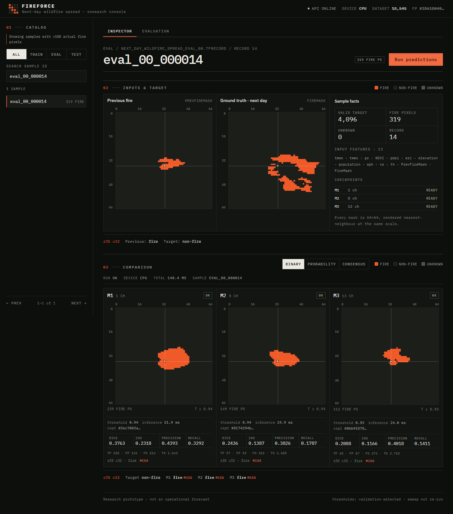

# Fireforce

A local research console for comparing three trained U-Net models on next-day
wildfire-spread data. Pick a stable sample ID, inspect the previous-fire and
ground-truth masks, run M1/M2/M3 on the same record, and compare binary masks,
probability maps, consensus, and valid-pixel metrics.

The catalog intentionally shows only samples with **more than 100 actual
ground-truth fire pixels** (2,377 of 18,545). All samples remain in the manifest
and API; omit `min_fire_pixels` to query the full catalog.

This is a research prototype, **not an operational wildfire forecast**.



## What is included

- **Backend** — FastAPI, deterministic sample catalog over TFRecord shards,
  shared preprocessing, strict checkpoint loading, masked metrics, partial
  failure handling, and evaluation endpoints.
- **Frontend** — React + Vite + TypeScript inspector and evaluation dashboard.
- **Evaluation** — fixed-seed 100-sample test-subset evaluation with per-sample
  JSON/CSV, micro and macro metrics, rankings, generated summary, and charts.
- **Validation** — Phase 0 parity tests against a frozen notebook transcription.
- **Docs** — full architecture, contracts, results, setup, and limitations in
  [HANDOFF.md](HANDOFF.md).

## Requirements

Data and model weights are intentionally **not** in the repository.

Place the files like this:

```text
fireforce/
  model_1_best.pth
  model_2_best.pth
  model_3_best.pth
  archive/
    next_day_wildfire_spread_train_00.tfrecord ... train_14
    next_day_wildfire_spread_eval_00.tfrecord ... eval_01
    next_day_wildfire_spread_test_00.tfrecord ... test_01
```

Python 3.13 and Node 20+ were used for validation.

## Quick start

```bash
# 1. Python dependencies
pip install -r backend/requirements-dev.txt

# 2. Build the deterministic sample index (~4.23 MB, gitignored)
python backend/tools/build_manifest.py

# 3. API (keep on port 8000)
python -m uvicorn app.main:app --app-dir backend --host 127.0.0.1 --port 8000

# 4. Frontend (second terminal, port 5173)
cd frontend
npm ci
npm run dev
```

Open <http://127.0.0.1:5173>. API docs are at
<http://127.0.0.1:8000/docs>.

If your shell resolves a Python without TensorFlow/PyTorch, use the interpreter
that has them installed, e.g. on this machine:

```bash
"C:\Users\rishi narkar\anaconda3\python.exe" -m uvicorn app.main:app --app-dir backend --host 127.0.0.1 --port 8000
```

The backend must use port 8000 and the frontend 5173 by default; CORS allows only
those local origins. Override the API URL with `VITE_API_BASE_URL` in
`frontend/.env.local` if needed.

## Evaluation

Generate the fixed-seed 100-sample **test** subset and dashboard summary:

```bash
python backend/tools/run_evaluation.py
```

Outputs are written to `artifacts/evaluation/100-test-v1/`:

- `samples.json` — exact selected IDs and sampling strategy
- `results.json` / `results.csv` — per-sample, per-model counts and metrics
- `summary.json` / `summary.csv` — aggregates, rankings, generated summary

The Evaluation tab reads `GET /api/evaluation/summary`.

## Tests

```bash
python -m pytest backend/tests -q
python backend/tools/validate_phase5.py
python backend/tools/smoke_http.py --base http://127.0.0.1:8000
cd frontend && npm test && npm run build
```

## Documentation

- [HANDOFF.md](HANDOFF.md) — architecture, model/checkpoint hashes, dataset and
  manifest statistics, preprocessing, API contracts, results, setup, known issues.
- [docs/screenshots](docs/screenshots/README.md) — inspector and evaluation states.
- [frontend/DESIGN.md](frontend/DESIGN.md) — interface concept and type/layout system.

## Scientific notes

- Unknown target pixels (`FireMask == -1`) are excluded from every metric.
- All-unknown targets produce unavailable metrics, never fabricated zeros.
- Thresholds (M1 0.94, M2 0.94, M3 0.93) are validation-selected values recorded
  in the original notebooks; they were not re-tuned here.
- The 100-sample evaluation is a fixed subset, not a full test-set estimate and
  not a statistical claim.
- No date, location, or event metadata is inferred from sample IDs.

## License

No license has been chosen for this repository yet. Add one before distributing
the code, and review the terms of the underlying dataset and model weights.
